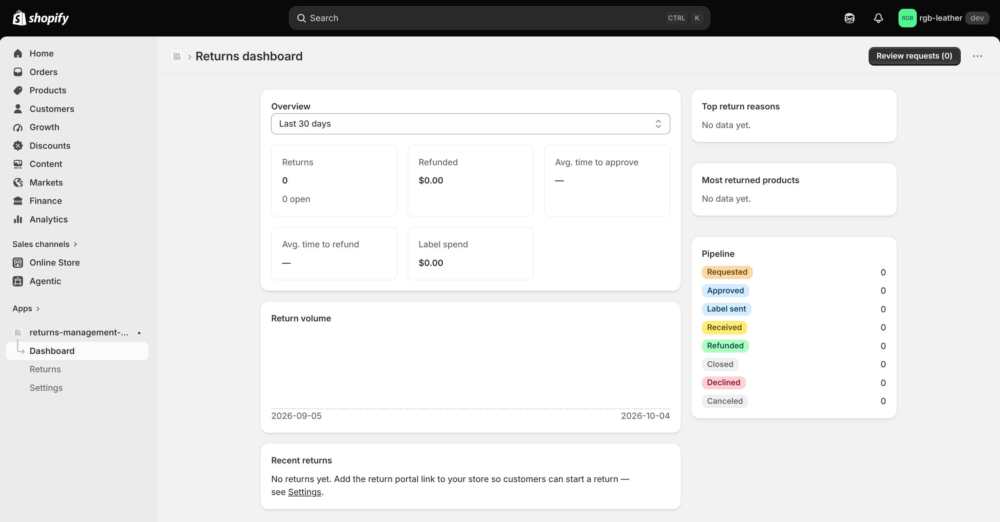
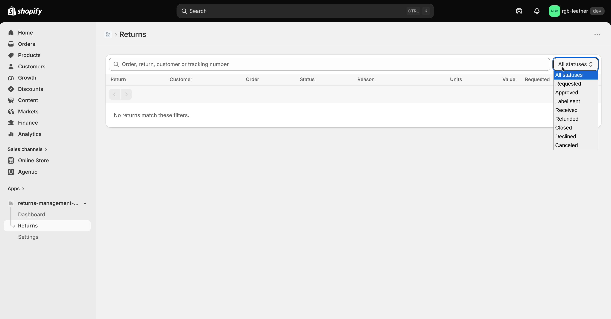
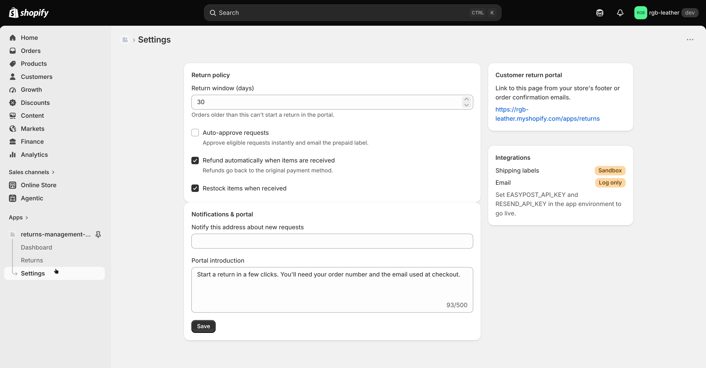

# Returns Management System

An embedded Shopify app that handles returns end to end: customers request a return from a self-service portal on the store, and the merchant approves, labels, receives and refunds it from one queue. It's built on Shopify's native Returns API, so every return also shows up on the order in the Shopify admin.



## What it does

Handling returns by hand means answering emails, checking order dates, making shipping labels, and remembering to refund and restock once the parcel arrives. This app does that work for the merchant:

- Customers start a return themselves by entering their order number and checkout email. The app checks that the order is within the return window and only offers items that Shopify reports as returnable.
- The merchant approves with one click. The app creates a prepaid return label, attaches the tracking to the return in Shopify, and emails the label to the customer.
- When the parcel arrives, the merchant marks it received. The app then refunds the original payment method and restocks the items automatically, if those settings are on.
- The dashboard shows how many returns came in, how much was refunded, how long approvals and refunds take, what labels cost, and which reasons and products come up most.

## How to use it

1. Open **Settings**, set the **Return window (days)** and choose whether to **Auto-approve requests**, **Refund automatically when items are received** and **Restock items when received**. Optionally add an email under **Notify this address about new requests** and edit the **Portal introduction**, then click **Save**.
2. Copy the link under **Customer return portal** (`https://<store>.myshopify.com/apps/returns`) and add it to your store's footer or order emails.
3. A customer opens the portal, enters their **Order number** and **Email used at checkout**, clicks **Find my order**, picks the items, a quantity and a reason for each, and clicks **Submit return request**.
4. On the **Dashboard**, click **Review requests (n)**, or open **Returns** and select the return.
5. Click **Approve & send label**, or **Decline** and choose a reason with an optional **Message to customer**.
6. When the parcel arrives, click **Mark as received**. If auto-refund is off, click **Issue refund** afterwards.

## Features

- **Dashboard:** returns count and open returns, refunded total, average time to approve and to refund, label spend, a daily return volume chart, top return reasons, most returned products, a status pipeline and recent returns. Ranges: last 7, 30 or 90 days.
- **Returns:** a list of all returns with search (order, return, customer or tracking number), a status filter and pagination.
- **Return detail:** items with reasons and customer notes, item value and refunded amount, the actions for the current status, an event timeline, and the return shipment (carrier, tracking link, **Print label**, postage cost).
- **Settings:** return policy, merchant alert email, portal intro text, the portal link, and whether shipping labels and email are live or in sandbox / log-only mode.
- **Customer return portal:** rendered inside the store's theme through a Shopify app proxy.
- **Customer emails:** request received, label (on approval), decline with the merchant's message, and refund confirmation. The merchant gets an alert email for each new request.
- **Sync with Shopify admin:** returns created or changed directly in Shopify (requested, approved, declined, canceled, closed) are mirrored in the app through webhooks.
- **Privacy compliance webhooks** for customer data requests and redaction.

## How it works

- **Status flow:** Requested → Approved → Label sent → Received → Refunded, or Requested → Declined. Returns can also end as Closed or Canceled from Shopify. A status only ever moves forward, so webhook echoes of the app's own actions can't roll a return back.
- **Return window:** an order can be returned if `now − order processed date ≤ return window days`.
- **Portal security:** an unknown order and a wrong email give the same error, so order numbers can't be guessed. After lookup, a signed token (HMAC-SHA256, valid 30 minutes) ties the next step to that order, and requested quantities are capped at Shopify's returnable quantity.
- **Labels:** with an EasyPost key, the app buys the cheapest rate for a return shipment, using an estimated parcel weight of 16 oz per unit. Without a key, it generates a sandbox PDF label marked as not valid for postage.
- **Refunds:** the refund amount comes from Shopify's suggested financial outcome for the returned items, refunded to the original payment methods. Restocking goes to the first active location Shopify returns for the shop.
- **Dashboard metrics:** average time to approve = mean of (approved − requested) hours; average time to refund = mean of (refunded − requested) hours; label spend = sum of label costs; top reasons and products are ranked by units returned.

## Screenshots

| Returns | Settings |
| --- | --- |
|  |  |
| Returns list with search and the status filter open | Return policy, notifications, portal link and integration status |

## Tech stack

React Router 7 with the Shopify app template, Polaris web components, Prisma + SQLite, Admin GraphQL API 2026-07, scopes `read_orders`, `write_returns`, `read_locations`.

## Run locally

Requires Node 22.12+ and the Shopify CLI.

```sh
npm install
npm run setup   # generate the Prisma client and run migrations
npm run dev     # shopify app dev
```

Then install the app on a development store, place and fulfil a test order, and open `https://<store>.myshopify.com/apps/returns`.

| Variable | Effect when set | Default |
| --- | --- | --- |
| `EASYPOST_API_KEY` | Buys real return labels through EasyPost | Sandbox PDF labels (not valid for postage) |
| `RESEND_API_KEY` | Sends emails through Resend | Emails are only logged to the console |
| `EMAIL_FROM` | Sender address for emails | `Returns <returns@example.com>` |

Notes:

- The portal reads customer emails and addresses, so the app needs **protected customer data** access (name, email, address) approved in the Partner Dashboard.
- Orders older than 60 days need the `read_all_orders` scope, which this app doesn't request.
- Receiving is manual. There is no carrier tracking webhook yet, so returns aren't marked received automatically.
